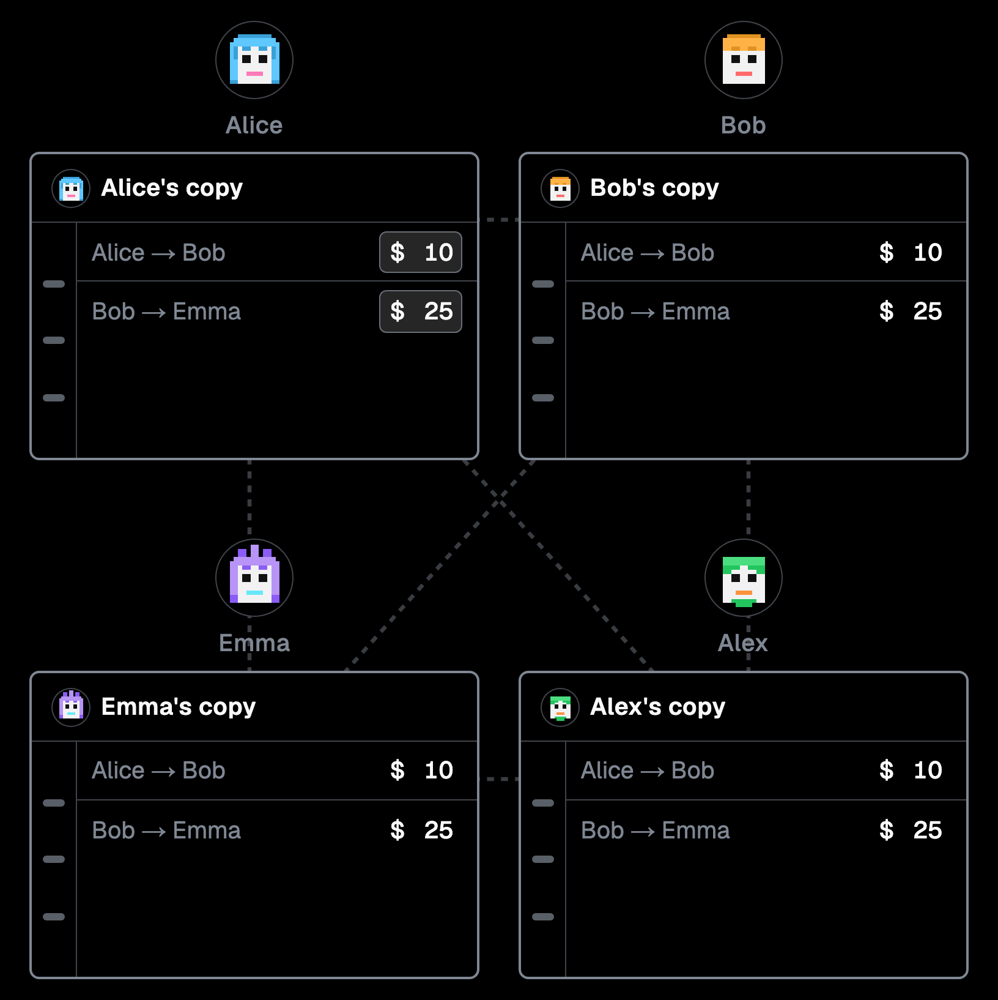

# BlockLearn

The diagrams are the product: you change them, the rules are tested functions, and each correct quiz answer moves progress in the browser.

**Live demo:** [https://block-learn-five.vercel.app](https://block-learn-five.vercel.app)



A short interactive course on how blockchains work. Five chapters: shared ledgers, hashes, consensus, transactions, and smart contracts.

## Deploy

Chapters are static pages (`generateStaticParams`).

1. Push the repo to GitHub.
2. Import the project on [Vercel](https://vercel.com).
3. Set `NEXT_PUBLIC_SITE_URL` to the production origin so sitemap, robots, and Open Graph URLs resolve.

To run it locally:

```bash
npm install
npm run dev
```

Open [http://localhost:3000](http://localhost:3000).

## Approach

Short chapters, diagrams you can change, and a quiz that records progress in the browser. There is no auth, database, or API.

- Course copy is typed TypeScript (`ContentBlock`), so lessons stay structured.
- Chapter pages are server-rendered. The heavy diagrams load as client components.
- Diagram rules (amounts, broadcasts, quiz attempts, race and stake outcomes) are pure functions with unit tests. Browser tests drive the screens.
- Quizzes support keyboard selection and live feedback. Animated diagrams respect reduced motion.

## Scripts

| Command | What it does |
| --- | --- |
| `npm run dev` | Dev server (Turbopack) |
| `npm run build` | Production build |
| `npm run start` | Serve the production build |
| `npm run lint` | ESLint |
| `npm run typecheck` | `tsc --noEmit` |
| `npm test` | Vitest unit tests |
| `npm run test:e2e` | Playwright: home syllabus and the interactive diagrams |

## Tests

- **Unit** (`npm test`) — course content shape, progress, the teaching fingerprint, and diagram rules: quiz attempts, the shared notebooks, the miner race, the stake walk, and the smart-contract steps.
- **Browser** (`npm run test:e2e`) — home syllabus, plus click-throughs of the shared ledger, the hash check, consensus playback, signing a transaction, and the smart-contract steps.

## Project map

```
app/                 # App Router pages, layouts, SEO routes
components/          # UI chrome and interactive diagrams
lib/                 # Course catalog, chapter content, quizzes, progress
public/images/       # Chapter artwork and the README screenshot
```

Diagram rules live next to each interactive in `*model.ts` and `story.ts`. `components/chapter-diagram.tsx` loads the diagrams. Course data is in `lib/course.ts`, `lib/content/`, and `lib/quizzes.ts`. Progress is `lib/progress.ts`.

## Progress model

Each quiz question is one progress unit. Answering every question in a chapter marks that chapter done. Progress stays in the browser (`localStorage`). Reset in the header clears it.

## Notes

- Dark UI is the course aesthetic.
- The hash demos use a short teaching fingerprint, labeled in the UI, so the lesson stays readable.
